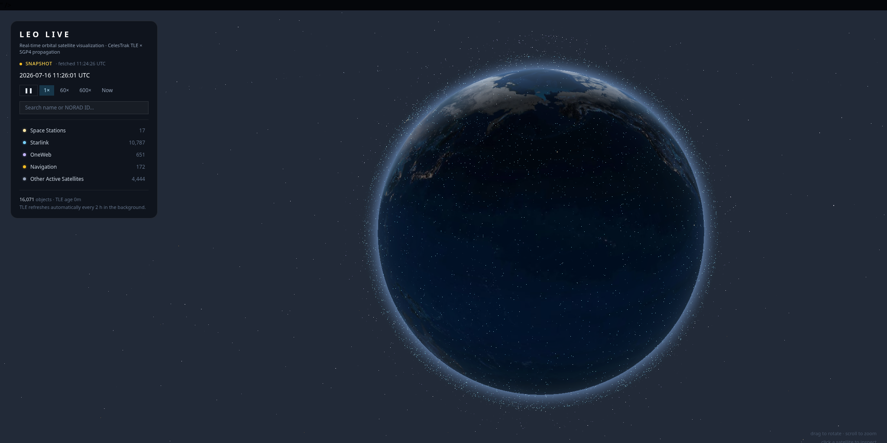
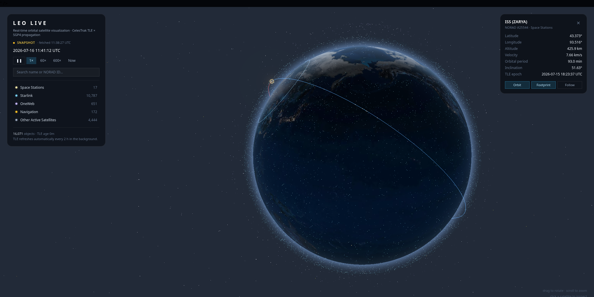
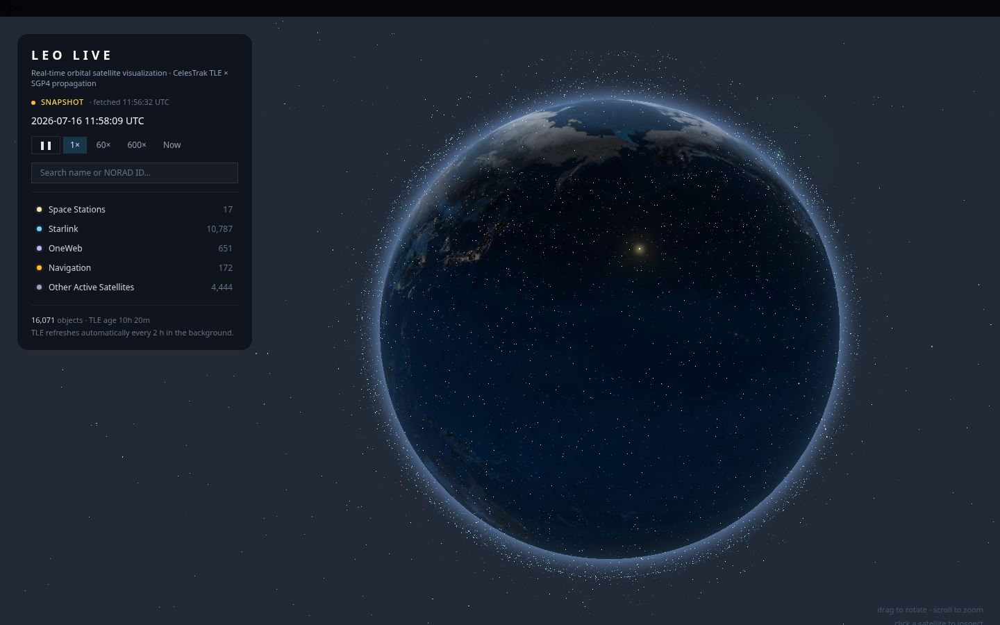
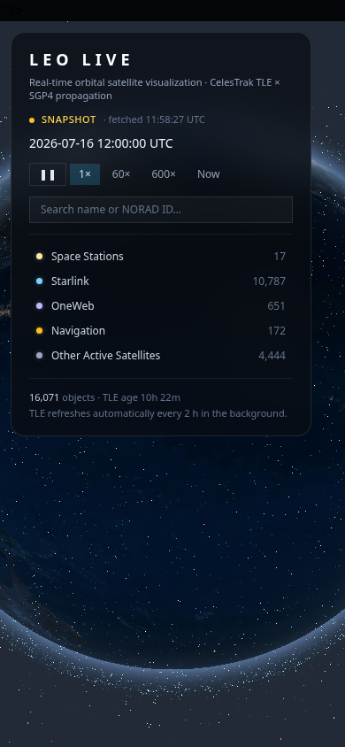
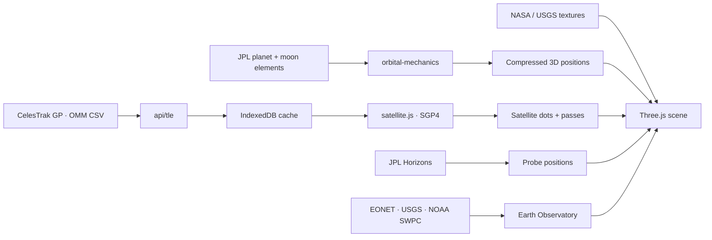

<div align="center">



<p>
  <a href="https://astrobender.vercel.app/"></a>
  
  
  
</p>

<p><em>The Sun, eight planets, their moons and every tracked satellite around Earth, in one Three.js scene.<br>
Click a body to fly to it and read its physical profile, chemistry and science notes. Then look up tonight's sky.</em></p>

<a href="https://astrobender.vercel.app/"></a>

</div>


## An observatory in a tab

Astrobender runs entirely in the browser. The planets sit where JPL's orbital elements put them, the satellites are propagated with SGP4 from live CelesTrak element sets, and a second layer watches the Earth itself: wildfires, storms, earthquakes, aurora and space weather. A third layer is about you: what is visible from where you stand tonight, and when.

The orbital order and geometry are real, but distances are compressed so billions of kilometres stay explorable on one screen. The app is honest about that trade instead of hiding it.

> **If a value has never been measured, it says so.** Physical profiles read *"no reliable measurement"* rather than inventing a number, AU labels always show the true semi-major axis, and a failed live feed shows its source and the HTTP or network reason while keeping the last valid data.


## Three views

<table>
  <tr>
    <td width="33%"></td>
    <td width="33%"></td>
    <td width="33%"></td>
  </tr>
  <tr>
    <td align="center"><code>search</code> · one box for everything</td>
    <td align="center"><code>laptop</code> · planet panel and layers</td>
    <td align="center"><code>mobile</code> · the same observatory</td>
  </tr>
</table>


## What's inside

| | |
|---|---|
| **Live 3D Earth** | Day and night textures, a cloud layer, specular oceans and thousands of satellite dots, each one a real element set. |
| **Planets and moons** | The Sun, eight planets, dwarf planets and the major moons, with ring systems drawn from the PDS ring tables. |
| **Physical profile** | Mass, density, surface gravity, temperature, chemistry and a science note for every body, from JPL's physical-parameter tables. |
| **GP (OMM) + SGP4** | CelesTrak element sets fetched as OMM CSV (catalogue numbers above 99999 included), propagated with `satellite.js` and cached in IndexedDB. |
| **Earth Observatory** | NASA EONET events, USGS earthquakes, NOAA aurora forecasts, Kp / G-scale and GOES X-ray flares. |
| **Sky calendar** | Eclipses with local visibility, moon phases and supermoons, the 12 major IMO meteor showers, oppositions, conjunctions and visible ISS / Tiangong passes. |
| **Observation planner** | Pick a target and see its altitude through the night from your location, with the useful-altitude band marked. |
| **Small bodies** | Close approaches from JPL CAD, comets looked up in SBDB, and asteroid and belt layers. |
| **Lagrange points** | Sun–Earth L1, L2, L4 and L5, and Jupiter's Trojan points, placed from JPL mass ratios. |
| **Landing sites** | 23 sites on the Moon, Mars, Venus, Titan and Earth, findable from the globe. |
| **Probes and missions** | Deep-space probes positioned from JPL Horizons ephemerides, and a mission timeline from the NSSDCA catalogue. |
| **Constellations** | All 88 IAU constellations over a bright-star catalogue. |
| **Scale sandbox** | Compare bodies at true relative size, away from the compressed scene. |
| **Cinematic tour** | A time-coded camera route narrated in Turkish and English. An optional ambient drone is synthesised live with Web Audio. |
| **One search box** | Finds a body, satellite, mission, surface location or NORAD number. |
| **Offline ready** | "Prepare for offline" caches textures and tour narration through the service worker and shows how much storage it uses. |


## Honest about scale

Real distances would put Neptune thirty times further out than Earth and leave every planet a single pixel. Astrobender compresses the AU curve and then tells you exactly how hard it is squeezing.

| Choice | Why |
|---|---|
| Orbits are drawn on a compressed AU curve; labels show the true semi-major axis. | Billions of kilometres stay explorable without lying about the numbers. |
| The scale panel shows how much the focused body's orbit is compressed, with ruler bars for real vs drawn. | You always know how far the picture is from reality. |
| The Sun is the one body drawn far below its true size (true is about 109 Earth radii). | At true size it would swallow Mercury's drawn orbit. |
| Textures load near a body (40 radii) and are released far from it (90 radii). | A full set of planetary maps would not fit on a phone; the gap stops load/release flapping. |
| Every data source has a review date; anything older than 120 days is flagged. | Sources drift. A weekly workflow checks them. |


## How the data flows



| Source | Used for |
|---|---|
| JPL SSD | Planet positions, moon elements, physical parameters, Lagrange mass ratios |
| JPL Horizons · SBDB / CAD | Deep-space probes, comets, close approaches |
| CelesTrak GP | Satellite element sets, refreshed weekly by a GitHub workflow snapshot |
| NASA EONET · USGS · NOAA SWPC | Natural events, earthquakes, aurora and space weather |
| IMO calendar | Meteor shower solar longitudes and ZHR |
| NSSDCA | Mission timeline |


## Kept honest by CI

| Workflow | When | Does |
|---|---|---|
| Quality | pushes to main, PRs | Tests, build and browser verification |
| GP snapshot refresh | Tuesdays 04:17 UTC | Pulls fresh CelesTrak element sets into `app/public/data/` and opens a PR |
| Source review | Mondays 09:00 UTC | Flags data sources past their review date |
| Production smoke | on demand | Loads the live site and checks it boots |
| Security review | PRs | Security review of the change |


## Türkçe özet

**Astrobender**, Güneş Sistemi'ni ve Dünya çevresindeki yapay uyduları aynı Three.js sahnesinde gösteren etkileşimli bir gözlemevi. Gezegenler JPL yörünge elemanlarıyla, uydular canlı CelesTrak verisinden SGP4 ile hesaplanıyor. Bir cisme tıklayınca kamera oraya uçuyor; kütle, yoğunluk, kimya ve bilim notları açılıyor. Dünya Gözlemevi katmanı yangın, deprem, aurora ve uzay havasını gösteriyor; gökyüzü takvimi tutulmaları, meteor yağmurlarını ve görünür ISS geçişlerini konumuna göre listeliyor. Mesafeler sıkıştırılmış ama gerçek değerler her zaman yazıyor; arayüz Türkçe ve İngilizce, çevrimdışı da çalışıyor.


## Development

```sh
cd app
npm install
npm run dev            # local dev server
npm test               # unit, catalogue and integrity tests
npm run test:e2e       # Playwright user flows
npm run verify         # lint + tests + build
npm run build          # production bundle
```

`NASA_API_KEY` is optional (APOD falls back to NASA's `DEMO_KEY`); `ASTROBENDER_BASE_URL` points the smoke test at a deployment.

```
api/                 Vercel functions: tle (GP/OMM), health, jpl-cad, nasa-feed
app/src/
  pages/Home.tsx     observatory and HUD composition
  lib/               orbital mechanics, OMM parsing, catalogue, physical profiles, scale honesty,
                     earth observatory, sky events, passes, Lagrange, probes, texture LOD
  components/hud/    info cards, search, layers, planner, sky calendar, tour controls
  hooks/             sim clock, propagator, feeds, offline storage
app/tests · app/e2e  unit and Playwright suites
screenshots/         README images
```

<div align="center">
<br>
<a href="https://github.com/kutluhangil"></a>
<sub>Orbits from JPL · satellites from CelesTrak · textures from NASA and USGS Astrogeology · the ISS pass in the banner is an example.</sub>
</div>
