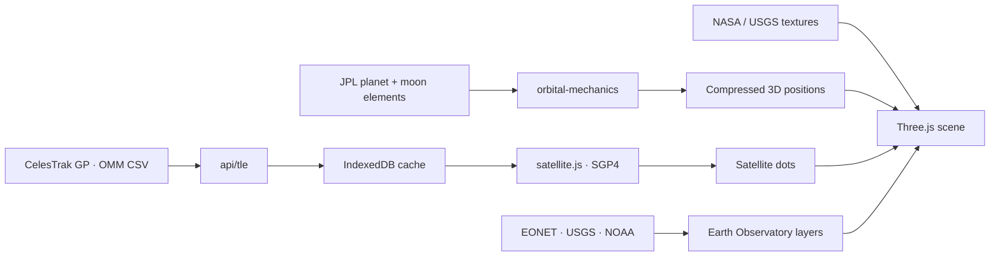

<div align="center">


<p>
  <a href="https://astrobender.vercel.app/"></a>
  
  
  
</p>

<p><em>The Sun, eight planets, their moons and every tracked satellite around Earth, in one Three.js scene.<br>
Click a body to fly to it and read its physical profile, chemistry and science notes.</em></p>

<a href="https://astrobender.vercel.app/"></a>

</div>


## What it is

Astrobender is an interactive observatory that runs entirely in the browser. The planets sit where JPL's orbital elements put them, the satellites are propagated with SGP4 from live CelesTrak data, and a second layer watches the Earth itself: wildfires, storms, earthquakes, aurora and space weather.

The orbital order and geometry are real, but distances are compressed so billions of kilometres stay explorable in a tab. AU labels always show the true semi-major axis.


## What's inside

| | |
|---|---|
| **Live 3D Earth** | Day and night textures, a cloud layer, specular oceans and thousands of satellite dots. |
| **Planets and moons** | The Sun, eight planets, dwarf planets and the major moons, including ringed giant systems. |
| **Physical profile** | Mass, density, surface gravity, temperature, chemistry and a science note for every body. If a value has never been measured, it says *"no reliable measurement"* instead of inventing one. |
| **GP (OMM) + SGP4** | CelesTrak element sets are fetched as OMM CSV (catalog numbers above 99999 included), propagated with `satellite.js` and cached in IndexedDB. |
| **Earth Observatory** | NASA EONET events, USGS earthquakes, NOAA aurora forecasts, Kp / G-scale and GOES X-ray flares. |
| **Sky calendar** | Eclipses with local visibility, moon phases and supermoons, the 12 major IMO meteor showers, oppositions, conjunctions and visible ISS / Tiangong passes. |
| **Small bodies** | Close approaches from JPL CAD, plus asteroid, comet and belt layers. |
| **Constellations and probes** | All 88 IAU constellations and the deep-space missions in the same view. |
| **Cinematic tour** | A time-coded camera route narrated in Turkish and English. |
| **One search box** | Finds a body, satellite, mission, surface location or NORAD number. |

<table>
  <tr>
    <td width="50%"></td>
    <td width="50%"></td>
  </tr>
  <tr>
    <td align="center"><code>search</code> · one box for everything</td>
    <td align="center"><code>laptop</code> · planet panel and layers</td>
  </tr>
</table>


## How the data flows



| Source | Used for |
|---|---|
| JPL SSD | Planet positions, moon elements, physical parameters |
| JPL Horizons · SBDB / CAD | Deep-space probes, comets, close approaches |
| CelesTrak GP | Satellite element sets, refreshed weekly by a GitHub workflow snapshot |
| NASA EONET · USGS · NOAA SWPC | Natural events, earthquakes, aurora and space weather |
| IMO calendar | Meteor shower solar longitudes and ZHR |

If a live feed fails, the app shows the source and the HTTP or network reason and keeps the last valid data.


## Türkçe özet

**Astrobender**, Güneş Sistemi'ni ve Dünya çevresindeki yapay uyduları aynı Three.js sahnesinde gösteren etkileşimli bir gözlemevi. Gezegenler JPL yörünge elemanlarıyla, uydular canlı CelesTrak verisinden SGP4 ile hesaplanıyor. Bir cisme tıklayınca kamera oraya uçuyor; kütle, yoğunluk, kimya ve bilim notları açılıyor. Dünya Gözlemevi katmanı NASA, USGS ve NOAA verileriyle yangın, deprem, aurora ve uzay havasını gösteriyor. Arayüz Türkçe ve İngilizce, hesap gerekmiyor.


## Development

```sh
cd app
npm install
npm run dev            # local dev server
npm test               # unit, catalog and integrity tests
npm run test:e2e       # Playwright user flows
npm run verify         # lint + tests + build
npm run build          # production bundle
```

```
api/                 Vercel functions: tle (GP/OMM), health, jpl-cad, nasa-feed
app/src/
  pages/Home.tsx     observatory and HUD composition
  lib/               globe engine, orbital mechanics, catalog, physical profiles,
                     earth observatory, OMM parsing, sky events, satellite passes
  components/hud/    info cards, search and layer controls
app/tests · app/e2e  unit and Playwright suites
screenshots/         README images
```

<div align="center">
<br>
<a href="https://github.com/kutluhangil"></a>
<sub>Orbits from JPL · satellites from CelesTrak · textures from NASA and USGS Astrogeology.</sub>
</div>
